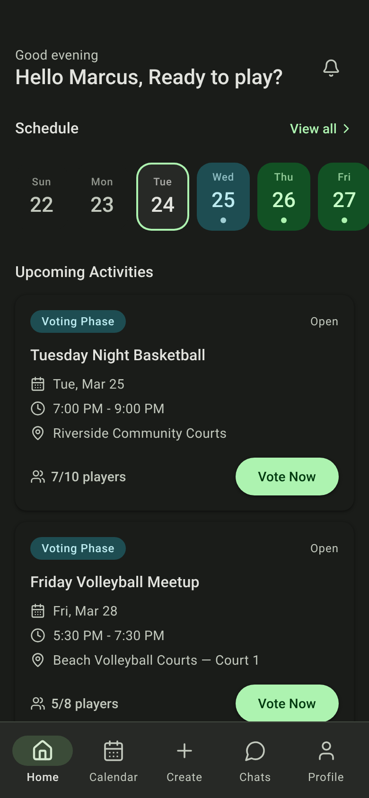
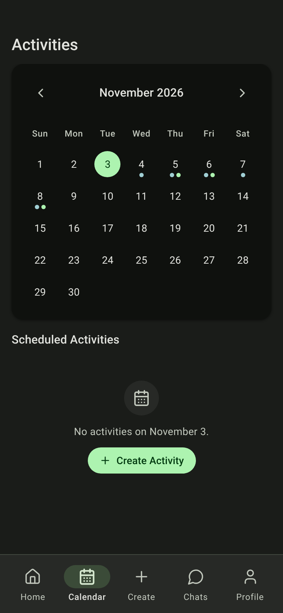
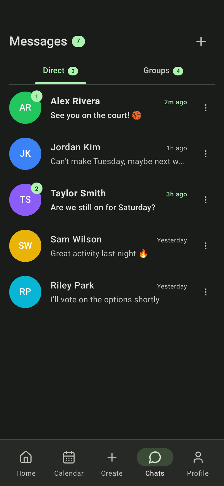
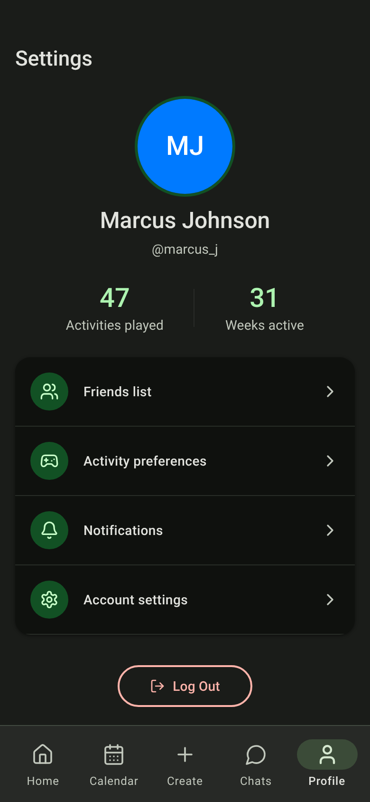

# OptIn

**Group plans, decided by vote.** OptIn is a mobile-first web app for getting a friend group to agree on when to do something. The organizer proposes a few times, everyone taps In, Maybe or Can't on each one, and the plan confirms or cancels itself when voting closes.

I designed and built it solo, from concept to a live app with real accounts. It started as coursework for CPFN 542 (Design for Mobile Devices, Toronto Metropolitan University) and I kept working on it after the course. Pickup sports was the first use case: a court costs money, a game needs a minimum headcount, and a no-show hurts everyone. The voting model works for any in-person plan, though, so it now covers dinners, game nights and anything else a group has to agree on.

**[Try the live app →](https://optinapp.vercel.app)**. Choose **Continue in Demo** on the sign-in screen to look around without an account.

<p>
  
  
  
  
</p>

## Status

**This is a finished side project and isn't actively maintained.** It works end to end, but it hasn't been hardened for real-world use, and it has the known issues listed below. I'm sharing it to show the design work and the path from concept to production.

## How it works

1. **Propose.** Create an activity with up to five time and place options, a cost split, a player limit and a voting deadline.
2. **Vote.** Invitees tap **In**, **Maybe** or **Can't** on each option. Options rank themselves by In votes.
3. **Decide.** When voting closes, the database confirms the winning option, breaks ties on Maybe votes, or cancels if not enough people are in. A tie that's still unresolved goes to the host.
4. **Show up.** Confirmed activities land on everyone's calendar, and attendance is recorded on their profiles once the activity is over.

There are also friends, direct messages and group chats, and you can sign in with email and password, Google, or both.

## Design

- **[DESIGN.md](DESIGN.md)**: the design system of record, covering Material 3 color roles (dark theme, green primary), type scale, components, and named rules with do's and don'ts.
- **[PRODUCT.md](PRODUCT.md)**: users, purpose, scope, and the decisions behind them, including why the app widened from sports to any group plan.
- **[guidelines/Guidelines.md](guidelines/Guidelines.md)**: the original coursework constraints (48dp touch targets, 4.5:1 contrast, 8pt grid).

## Stack

| | |
| --- | --- |
| App | React 18, TypeScript, Vite, React Router, Tailwind CSS v4, shadcn/ui (Radix) |
| Backend | [Neon](https://neon.tech) Postgres, with Neon Auth for sign-in and the Data API for queries |
| Hosting | Vercel |

There is no app server. The browser talks to the database directly, and **Postgres row-level security is what controls access**. The rules that matter are enforced in SQL, not in the client: the activity lifecycle, vote tallying, friends-only messaging, and who can join what. The whole schema is in [neon/schema.sql](neon/schema.sql).

Updates poll every few seconds rather than streaming in real time, and polling pauses while the tab is hidden.

## Run it locally

```bash
npm install
npm run dev
```

With no environment variables set, the app runs in **demo mode** on built-in mock data, so you don't need a database.

To connect a real backend, create a Neon project with Auth and the Data API enabled, apply `neon/schema.sql`, and put the database URL in `.env.local`:

```bash
VITE_NEON_URL=https://<endpoint>.neon.tech/<database>
```

`npm run typecheck` and `npm run build` are the only checks. There is no test suite.

## Known issues

- **Deadlines only resolve when someone opens the app.** Nothing runs on a schedule, so an activity stays open past its deadline until someone loads Home or Calendar.
- **No push notifications.** Invites, votes and messages only show up while the app is open.
- **The vocabulary is still partly about sport.** Plans are "activities" now, but participants are still called "players" and the "roster", and only sport types have hero photos. Other types get a gray placeholder.
- **One fixed time zone.** All times are interpreted as America/New_York.
- **Google sign-in only works on the production domain** and localhost, not on Vercel preview deployments.

## Process

The first layouts came from Figma Make, generated from a detailed spec written in Notion. Most of the code since then was written with Claude Code, with me making the design, product and architecture decisions. [CLAUDE.md](CLAUDE.md) is the working brief the AI tooling used, and it doubles as the most detailed architecture notes in the repo. Third-party assets are credited in [ATTRIBUTIONS.md](ATTRIBUTIONS.md).

Original design file: [Figma](https://www.figma.com/design/EvhkFX6lCj3wX6GTKyZrAl/CFPN542-Project?node-id=89-317)

Built by Philos Himm.
